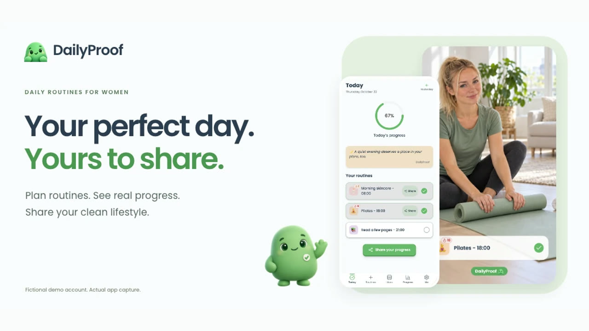
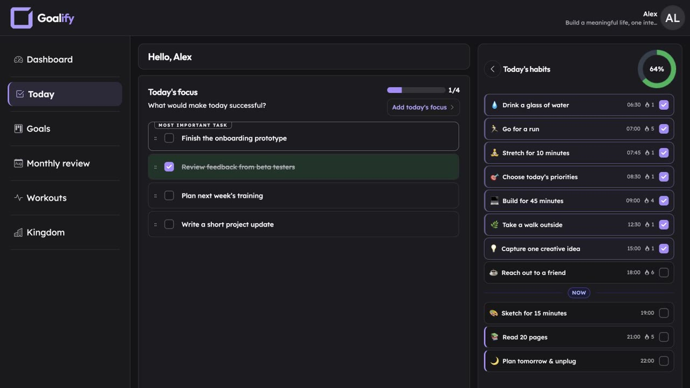
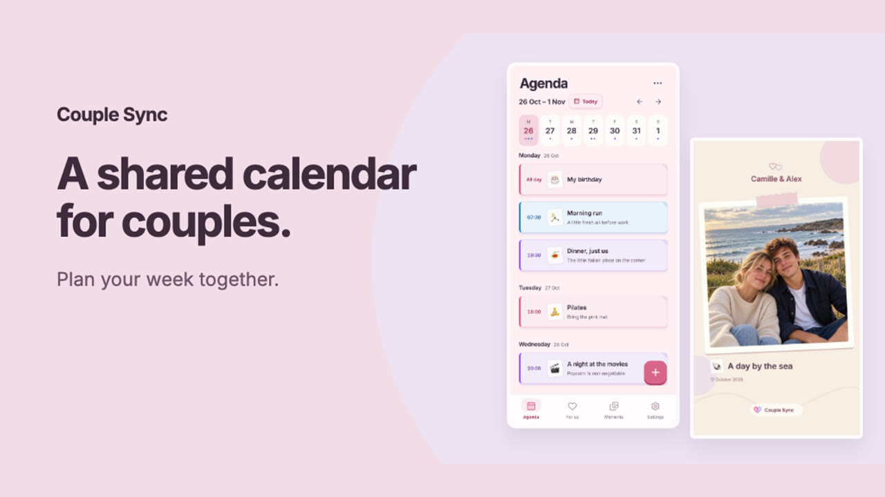
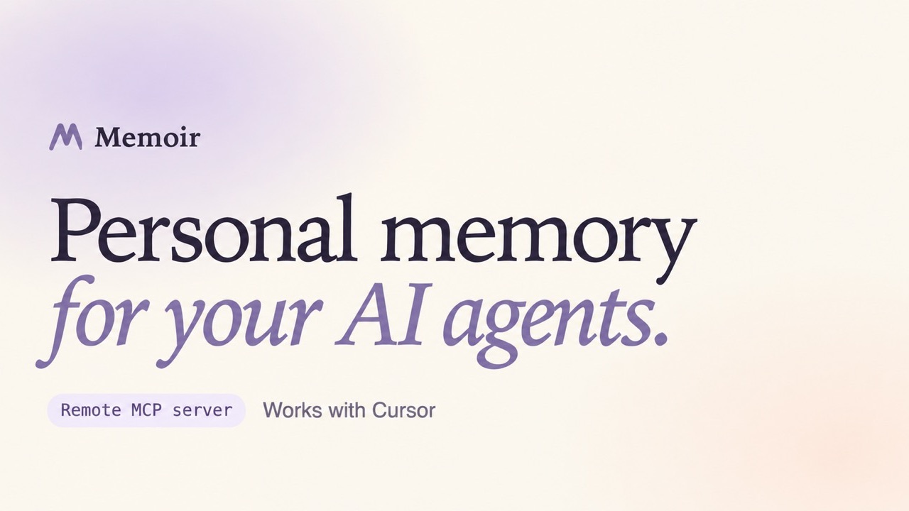

<table>
<tr>
<td>

<a href="https://x.com/florent_tech_"><picture><source media="(prefers-color-scheme: dark)" srcset="https://cdn.simpleicons.org/x/white"/></picture></a>

<h3>👋 Hey! I'm Florent — software engineer building with AI</h3>

📍 Paris · 🛠️ Software Engineer @ Wezen · 🌐 <a href="https://florent.lepape.me/">florent.lepape.me</a>
</td>
</tr>
<tr>
<td>

</td>
</tr>
<tr>
<td>
<b>languages</b> 
 TypeScript&nbsp;&nbsp; Java&nbsp;&nbsp; Python&nbsp;&nbsp; C&nbsp;&nbsp; C++
</td>
</tr>
<tr>
<td>
<b>frontend</b> 
 Angular&nbsp;&nbsp; Next.js
</td>
</tr>
<tr>
<td>
<b>backend</b> 
 Spring Boot&nbsp;&nbsp; PostgreSQL
</td>
</tr>
<tr>
<td>
<b>agents / ai</b> 
 MCP&nbsp;&nbsp; Claude Code&nbsp;&nbsp; Cursor&nbsp;&nbsp; Gemini&nbsp;&nbsp; RAG &amp; embeddings
</td>
</tr>
<tr>
<td>
<b>infra</b> 
 AWS&nbsp;&nbsp; Azure&nbsp;&nbsp; Docker&nbsp;&nbsp; GitHub Actions
</td>
</tr>
</table>

<b>What I'm building</b>

 

| Project | What it is |
|---|---|
| [DailyProof](https://dailyproof.florent-tech.com/) | Mobile app — plan routines, see real progress, share your day |
| [Goalify](https://goalify-website.lepape.me/) | Personal execution system — long-term goals into daily action |
| [Couple Sync](https://couple-sync-website.vercel.app/) | A shared calendar for couples — plan your week together |
| [Memoir](https://memoir.florent-tech.com/) | Remote MCP server: personal memory for your AI agents, EU-hosted |
| [Florent_tech](https://florent-tech.com/) | AI & tech explained simply, in French, in three minutes |
| [GitNotifier](https://gitnotifier.com/) | GitHub pull request updates straight to your Slack DMs |

> Great systems turn ambition into daily execution.
